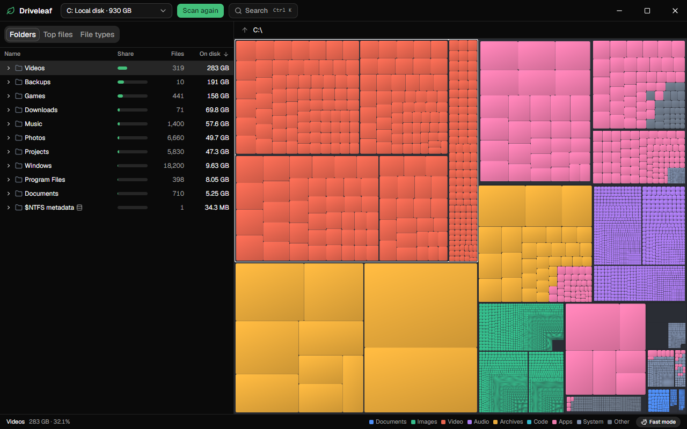
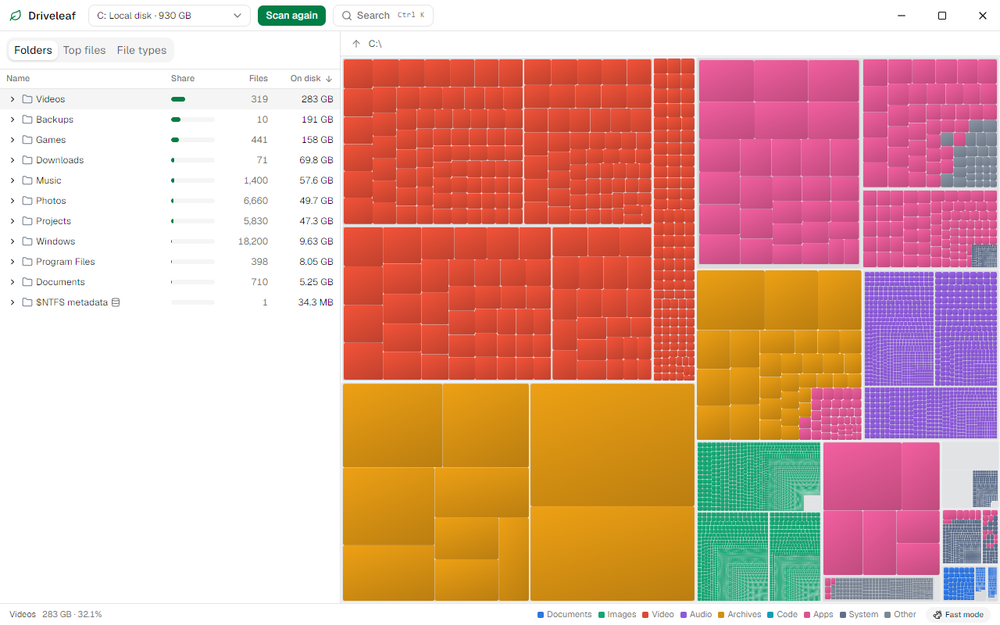

# Driveleaf

A fast, open-source disk space analyzer for Windows. Driveleaf reads the NTFS
Master File Table directly instead of walking folders, so a full drive takes
moments, and it shows what fills your disk as a treemap you can click through.

[Leia em português](README.pt-BR.md)



## What it does

- **Scans in moments.** With administrator rights it reads the MFT in parallel:
  0.32 s for 712,000 records on a fast NVMe drive ([details](docs/benchmarks.md)).
- **Works without administrator rights too.** It falls back to a parallel folder
  walk, and that is also how it handles exFAT, ReFS and network drives.
- **Adds up to the disk.** Hard links count once, compressed and sparse files
  count what they really occupy, and NTFS's own metadata sits in its own folder.
- **Stays fluid.** The treemap draws up to 200,000 tiles with WebGL2 and hit
  testing never waits for the backend.
- **Finds things.** Largest files, space per file type, and `Ctrl+K` to search
  every name on the drive.
- **Is careful with your files.** It only reads, unless you ask. Removing sends
  to the Recycle Bin, always after a confirmation, and refuses system files.



## Install

Driveleaf has no public release yet. When it does, the installer and a portable
`.exe` will be on the releases page, and on `winget` and Scoop.

## Using it

Pick a drive and press **Scan**. Click anything to select it in both views,
double-click a folder to zoom in, and use the breadcrumb or `Backspace` to go
back. Right-click for actions.

| Key | Action |
|---|---|
| `Ctrl+K` | Search by name |
| `F5` | Scan again |
| `Backspace` | Up one level |
| `Enter` | Open the selected folder in the treemap |
| `Delete` | Send the selected item to the Recycle Bin, after confirming |

The app starts without administrator rights. If it scans in slow mode, the status
bar offers **Reopen as administrator**, which shows the normal Windows prompt.

### How sizes are counted

- **On disk** is the space an item really occupies, which is what adds up to the
  used space of the volume. **Size** is its logical length.
- A file with several hard links counts at its first name. The other names show
  a link mark and add nothing to their folders.
- Alternate data streams count towards size on disk, and so does the data of
  files compressed by CompactOS.
- Small files that fit inside their MFT record use no clusters of their own. That
  space shows under `$MFT`.
- Symbolic links and junctions are listed but never followed.
- Cloud files that are not on this disk take no space.

## Privacy

Driveleaf makes no network connections and collects nothing. There is no
telemetry, no update check and no remote content, and a strict content security
policy holds the interface to that.

## Building from source

Everything builds from Linux or WSL, and nothing needs installing on Windows
beyond the WebView2 runtime it already ships with.

```bash
sudo apt-get install -y build-essential pkg-config clang lld llvm nsis
cargo install --locked cargo-xwin
cargo test                       # engine tests
bash scripts/windows-build.sh    # release binaries, copied to the Windows disk
bash scripts/dev.sh              # Vite in WSL, the Windows app on Windows
```

Native Windows works too: install the MSVC Build Tools, Rust and Node.js, then run
`npm install` and `npm run tauri dev` in `apps/desktop`. See
[CONTRIBUTING.md](CONTRIBUTING.md).

## Reusing the engine

The scanner has no GUI dependency, so other tools can use it.

| Crate | What it is |
|---|---|
| `driveleaf-ntfs` | MFT parser (portable, no `unsafe`) and Windows volume reader |
| `driveleaf-core` | Disk usage model, aggregation, queries and the folder walker |
| `driveleaf-treemap` | Squarified treemap layout |
| `driveleaf-cli` | `driveleaf-cli scan C: --format json` and friends |

See [the architecture notes](docs/architecture.md).

## License

Licensed under either of [MIT](LICENSE-MIT) or [Apache-2.0](LICENSE-APACHE) at
your option. Contributions are accepted under the same terms.
