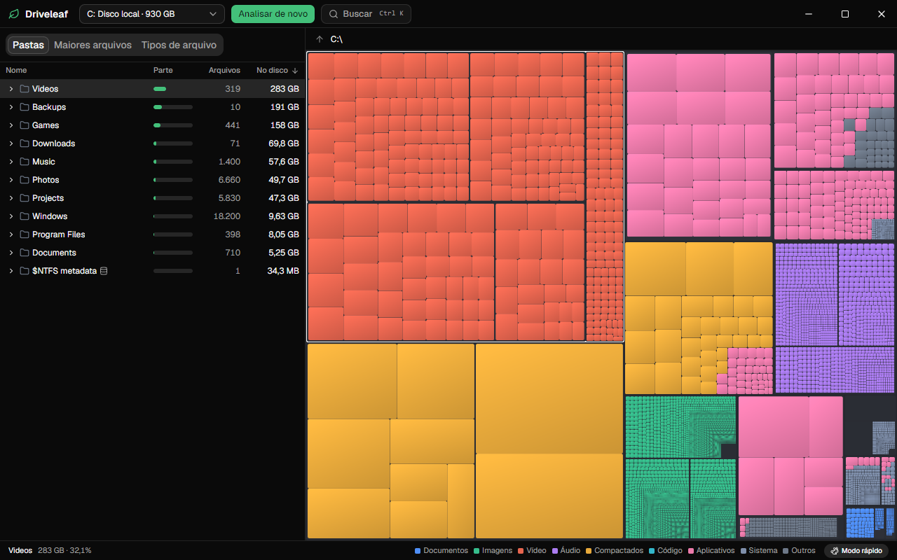

# Driveleaf

Um analisador de espaço em disco rápido e de código aberto para Windows. O
Driveleaf lê direto a Master File Table do NTFS em vez de percorrer pastas, então
uma unidade inteira leva instantes, e mostra o que ocupa o seu disco num treemap
que você explora com cliques.

[Read in English](README.md)



## O que ele faz

- **Analisa em instantes.** Com permissão de administrador, lê a MFT em paralelo:
  0,39 s para 711 mil registros em um NVMe rápido ([detalhes](docs/benchmarks.md)).
- **Também funciona sem administrador.** Nesse caso percorre as pastas em paralelo,
  e é assim também que trata exFAT, ReFS e unidades de rede.
- **Fecha a conta com o disco.** Hard links contam uma vez, arquivos comprimidos e
  esparsos contam o que ocupam de verdade, e os metadados do NTFS ficam numa
  pasta própria.
- **Continua fluido.** O treemap desenha até 200 mil retângulos com WebGL2, e o
  hit test nunca espera o backend.
- **Encontra as coisas.** Maiores arquivos, espaço por tipo de arquivo e `Ctrl+K`
  para buscar qualquer nome da unidade.
- **Cuida dos seus arquivos.** Só lê, a não ser que você peça. Remover envia para
  a Lixeira, sempre com confirmação, e arquivos de sistema são recusados.

## Instalação

O Driveleaf ainda não tem versão pública. Quando tiver, o instalador e um `.exe`
portátil vão estar na página de versões, além do `winget` e do Scoop.

## Como usar

Escolha uma unidade e clique em **Analisar**. Clique em qualquer item para
selecioná-lo nas duas visões, dê dois cliques numa pasta para ampliar, e use o
caminho no topo ou `Backspace` para voltar. O botão direito abre as ações.

| Tecla | Ação |
|---|---|
| `Ctrl+K` | Buscar pelo nome |
| `F5` | Analisar de novo |
| `Backspace` | Subir um nível |
| `Enter` | Abrir no treemap a pasta selecionada |
| `Delete` | Enviar o item selecionado para a Lixeira, após confirmar |

O app abre sem permissão de administrador. Se analisar no modo lento, a barra de
status oferece **Reabrir como administrador**, que mostra o aviso normal do Windows.

### Como os tamanhos são contados

- **No disco** é o espaço que o item ocupa de verdade, e é isso que soma o espaço
  usado do volume. **Tamanho** é o comprimento lógico.
- Um arquivo com vários hard links conta no primeiro nome. Os outros nomes mostram
  uma marca de link e não somam nada nas pastas.
- Fluxos alternativos de dados contam no tamanho no disco, assim como os dados de
  arquivos comprimidos pelo CompactOS.
- Arquivos pequenos que cabem no próprio registro da MFT não usam clusters. Esse
  espaço aparece em `$MFT`.
- Links simbólicos e junctions aparecem na lista, mas nunca são seguidos.
- Arquivos na nuvem que não estão neste disco não ocupam espaço.

## Privacidade

O Driveleaf não faz conexões de rede e não coleta nada. Não há telemetria, busca
por atualizações nem conteúdo remoto, e uma política de segurança de conteúdo
estrita garante isso na interface.

## Compilar a partir do código

Tudo compila a partir do Linux ou do WSL, e nada precisa ser instalado no Windows
além do WebView2, que já vem no sistema.

```bash
sudo apt-get install -y build-essential pkg-config clang lld llvm nsis
cargo install --locked cargo-xwin
cargo test                       # testes do motor
bash scripts/windows-build.sh    # binários finais, copiados para o disco do Windows
bash scripts/dev.sh              # Vite no WSL, o app no Windows
```

Também funciona de forma nativa: instale o MSVC Build Tools, Rust e Node.js, e rode
`npm install` e `npm run tauri dev` em `apps/desktop`. Veja
[CONTRIBUTING.md](CONTRIBUTING.md), em inglês.

## Licença

Licenciado sob [MIT](LICENSE-MIT) ou [Apache-2.0](LICENSE-APACHE), à sua escolha.
Contribuições são aceitas nos mesmos termos.
